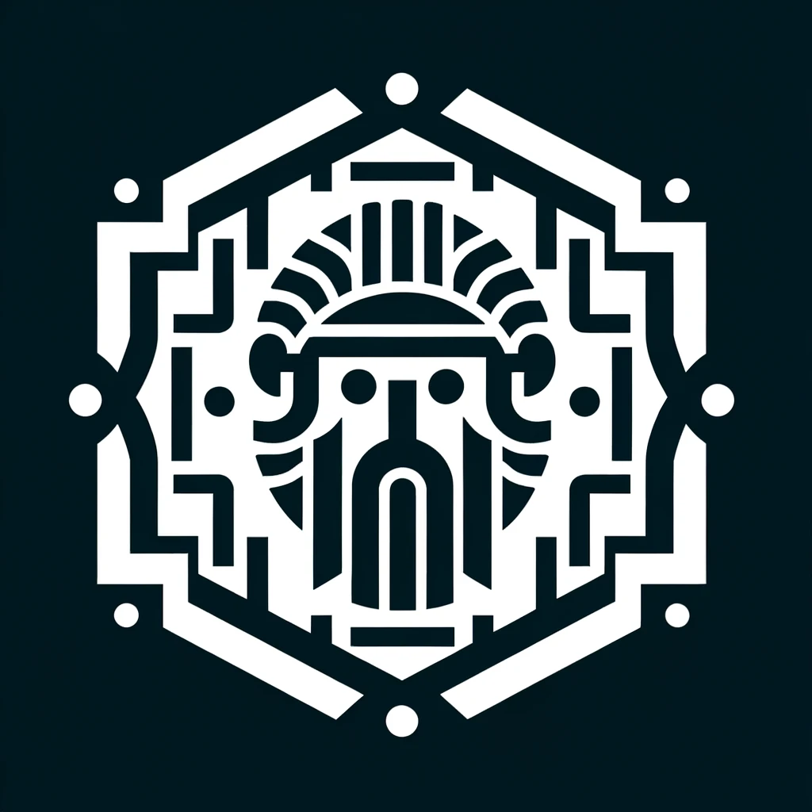
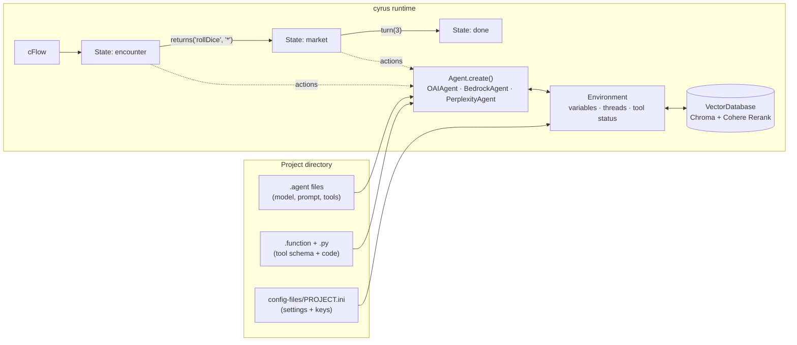

<p align="center">
  
</p>

<h1 align="center">Cyrus Agent Framework</h1>

<p align="center">
  Wire LLM agents from different providers into state-machine workflows.<br>
  Agents are JSON files, tools are plain Python functions, and flows jump between states the moment a condition fires.
</p>

---

Cyrus is the multi-agent framework I built in the first half of 2024, back when "agent" mostly meant a chat loop with a function call bolted on. It treats a multi-agent app as a flow: a set of **states**, each running a list of **actions** (an agent talks to the user, two agents talk to each other, a tool gets called, a variable gets set), joined by **transitions** that are checked concurrently while the actions run. When the Dungeon Master agent rolls a die mid-conversation, the flow notices and moves on to the next scene without waiting for the conversation to wind down.

Every agent shares one **environment**: a whiteboard of variables, tool-call status and conversation threads, backed by a vector memory. Agents can be GPT-4o, Claude 3 on Bedrock, Command R, Mistral Large or a Perplexity online model, and each one uses the same `.function` tool definitions.

## Features

- **Provider-agnostic agents.** One `Agent.create("dm")` call loads a JSON agent file and returns an OpenAI, Bedrock or Perplexity agent. Tool calling is normalized across OpenAI chat completions and the Bedrock Converse API, including a capability table that drops system prompts or tools for models that can't take them.
- **Tools as plain Python.** Drop `rollDice.function` (a JSON Schema) and `rollDice.py` (a normal function) into a project, list it on an agent, and every provider can call it. Cyrus tracks each tool's status so flows can react to it.
- **Concurrent state machine.** `cFlow` runs a state's actions and its transition checks as parallel asyncio tasks. Conditions can be lambdas, coroutines, booleans or composable condition objects (`returns`, `is_called`, `turn`, `and_`, `in_` and friends).
- **Shared environment.** A singleton `Environment` holds dotted-path variables (`party.gold`), conversation threads scored by state, membership and recency, and function status, so any agent or action can read what the others did.
- **Retrieval memory.** Messages and documents are embedded with OpenAI `text-embedding-3-small` into Chroma, with optional Cohere Rerank. Memory can be scoped per conversation, per state or per agent.
- **Streamlit studio.** Point-and-click tools for creating projects and API-key configs, building agents (with generated mascot avatars), writing tools in an in-browser code editor, and sketching flows as a graph.
- **VS Code extension.** Syntax highlighting for `.agent`, `.function` and `.cflow` files.

## How it fits together



The full tour of each piece lives in [docs/architecture.md](docs/architecture.md).

## Example

The bundled D&D project pits the player against a Dungeon Master (Claude 3 Haiku on Bedrock), then hands the scene to a haggling goblin merchant (GPT-4o) once the first die is rolled:

```python
import asyncio
from cyrus import Agent, Environment, State, Transition, cFlow, println, returns, talks_to, turn


async def main():
    Environment.getInstance(project_name="dnd")
    dm = await Agent.create("dm")
    merchant = await Agent.create("merchant")

    encounter = State("encounter", [talks_to("user", dm, context="Set up a fight and roll initiative.")])
    market = State("market", [talks_to(dm, merchant, context="Haggle over the loot.")])
    done = State("done", [println("Completed flow")])

    flow = cFlow.getInstance(
        [encounter, market, done],
        encounter,
        [Transition(encounter, market, returns("rollDice", "*")), Transition(market, done, turn(3))],
    )
    await flow.run()


asyncio.run(main())
```

An agent is a small JSON file:

```json
{
    "platform": "bedrock",
    "name": "Dungeon Master",
    "role": "dm-haiku",
    "system_prompt": "You are the Dungeon Master, a seasoned storyteller...",
    "model": "anthropic.claude-3-haiku-20240307-v1:0",
    "functions": ["rollDice"]
}
```

## Quickstart

Cyrus targets Python 3.12 and the mid-2024 provider SDKs (`openai` 1.x, `boto3` with the Bedrock Converse API, `chromadb` 0.5, `cohere` 5). `setup.py` pins those ranges.

```bash
git clone https://github.com/joey12725/cyrus-agent-framework.git
cd cyrus-agent-framework

# The core test suite runs offline with the provider SDKs stubbed out
python3.12 -m unittest discover -s tests -t .

# Install the framework (add [gui] for the Streamlit studio)
python3.12 -m venv .venv && source .venv/bin/activate
pip install -e ".[gui]"
```

Talk to the Dungeon Master:

```bash
cd examples/dnd-chat-bot
cp config-files/dnd.ini.example config-files/dnd.ini   # add keys here, or export them
export OPENAI_API_KEY=...            # embeddings for memory, plus the GPT-4o merchant
export AWS_ACCESS_KEY_ID=... AWS_SECRET_ACCESS_KEY=...   # Bedrock access to Claude 3 Haiku
export COHERE_API_KEY=...
python chat.py        # one-on-one chat
python flow_demo.py   # the three-state flow above
```

Open the studio:

```bash
cd front-end
cp config-files/dnd.ini.example config-files/dnd.ini
streamlit run agent-configuration.py      # also: config-editor.py, function-configuration.py, flow-generator.py
```

## Project layout

```
cyrus/
  agent.py         Agent base class + OpenAI, Perplexity and Bedrock agents, tool dispatch
  actions.py       talks_to, cot, call, let, println, loop, go_to, terminate
  states.py        State (runs actions, renders node icons for the flow graph)
  transition.py    Transition (condition check, sync or async)
  functions.py     Composable conditions: returns, is_called, turn, and_, or_, in_, ...
  flow.py          cFlow, the concurrent state-machine runner
  environment.py   Environment singleton, Thread/Message, VectorDatabase memory
examples/dnd-chat-bot/   Agents, tools and runnable scripts for the D&D demo
front-end/               Streamlit studio + generated agent avatars
vscode-extension/        Syntax support for .agent, .function and .cflow
tests/                   Offline unit tests for the core runtime
```

## Tech stack

Python 3.12 · asyncio · OpenAI Chat Completions · Amazon Bedrock Converse · Perplexity API · Chroma · Cohere Rerank · Streamlit · Rich · Pillow · VS Code TextMate grammars

## What came next

The ideas here (shared workspace, provider-neutral agents, event-driven hand-offs) grew into [Cyrus v2](https://github.com/joey12725/Cyrus-v2), an autonomous agent orchestration platform built on a project-management backbone.

---

Built by **Joey Hersh** in 2024. Released under the [MIT License](LICENSE).
